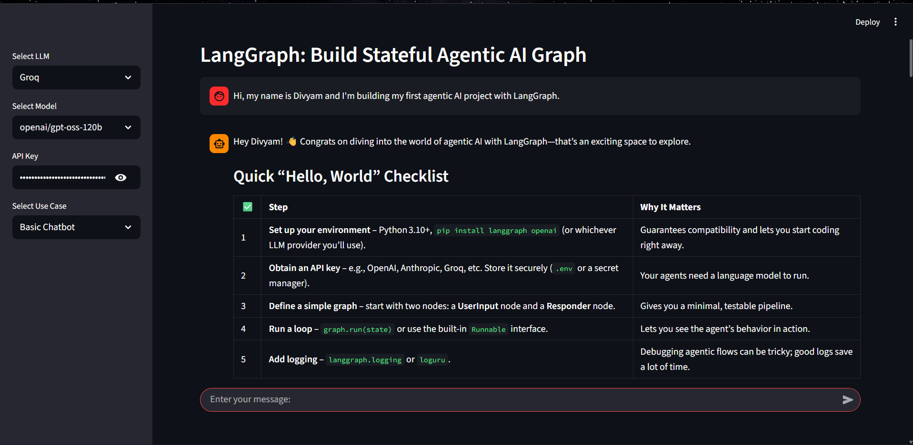
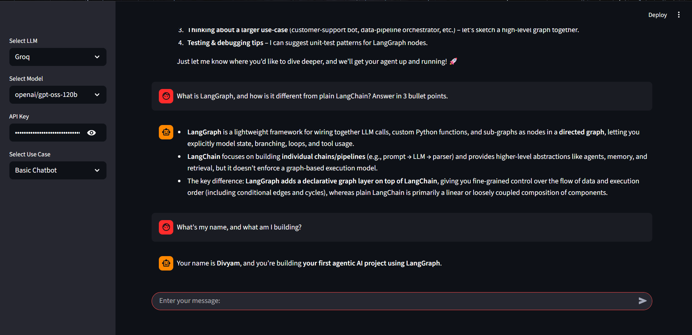

# Agentic Chatbot

A chatbot built with **LangGraph**, **Groq** and **Streamlit**, with two modes: a basic chatbot and a chatbot that can search the web (Tavily).

> This is my **first end-to-end Agentic AI project**. It is intentionally small: one LLM, two simple graphs. The goal was to learn how the pieces (UI, LLM, graph, state) fit together before building more complex agents.

## Demo

Sidebar controls (LLM, model, API key, use case) and a first reply:



Multi-turn memory - the bot remembers the name from the first message:



## How it works

Pick a use case in the sidebar. Each one builds a different LangGraph workflow.

**1. Basic Chatbot** - a single-node graph:

```
START  ->  chatbot (LLM)  ->  END
```

**2. Chatbot with Web** - the LLM can call a Tavily search tool and loop back with the results:

```
START  ->  chatbot  --(needs a tool?)-->  tools  -->  chatbot ... --> END
```

1. The user picks a Groq model and enters the API key(s) in the Streamlit sidebar.
2. The user's message is added to the graph `State` (a list of messages).
3. The `chatbot` node sends the full message history to the LLM. In web mode the LLM is bound to the search tool, and `tools_condition` routes to the `tools` node whenever the LLM asks for a search.
4. Streamlit renders the conversation (tool results show in an expander). History is kept in `st.session_state`, so the bot remembers earlier turns within a session.

## Tech stack

- [LangGraph](https://github.com/langchain-ai/langgraph) - graph / state orchestration
- [LangChain](https://github.com/langchain-ai/langchain) + `langchain-groq` - LLM interface
- [Groq](https://groq.com/) - LLM inference
- [Tavily](https://tavily.com/) (`langchain-tavily`) - web search tool
- [Streamlit](https://streamlit.io/) - frontend

## Project structure

```
Agentic-Chatbot/
├── app.py                          # Entry point
├── requirements.txt
└── src/langgraphagenticai/
    ├── main.py                     # Wires UI + LLM + graph together
    ├── LLMs/groqllm.py             # Groq model setup
    ├── graphs/graph_builder.py     # Builds and compiles the LangGraph graphs
    ├── nodes/
    │   ├── basic_chatbot_node.py   # Basic chatbot node
    │   └── chatbot_tools_node.py   # Chatbot node with tools bound
    ├── tools/search_tool.py        # Tavily search tool + ToolNode
    ├── states/state.py             # Graph state definition
    └── ui/
        ├── uiconfigfile.ini        # Page title, model and use-case options
        ├── uiconfigfile.py         # Config reader
        └── streamlit/
            ├── loadui.py           # Sidebar + controls
            └── display_result.py   # Chat rendering
```

## Getting started

**Prerequisites:** Python 3.10+, a free [Groq API key](https://console.groq.com/keys), and (for the web-search mode) a free [Tavily API key](https://app.tavily.com/).

```bash
git clone https://github.com/Divyamchoudharyy/Agentic-Chatbot.git
cd Agentic-Chatbot

python -m venv venv
# Windows: venv\Scripts\activate
# macOS/Linux: source venv/bin/activate

pip install -r requirements.txt
streamlit run app.py
```

Run the command from the project root. Then paste your Groq API key in the sidebar (or set the `GROQ_API_KEY` environment variable) and start chatting. For "Chatbot with Web", also enter your Tavily key (or set `TAVILY_API_KEY`).

> Tip: for web search, `openai/gpt-oss-120b` handles tool calling more reliably than the smaller models.

## Roadmap

- [x] Web search tool (Tavily) for a tool-using agent
- [x] Conditional edges / routing between nodes
- [ ] Persistent memory across sessions
- [ ] More LLM providers (OpenAI, Ollama)
- [ ] Pin dependency versions

## What I learned

- Structuring a LangGraph app: state, nodes, edges, compile
- Tool calling and conditional routing (`tools_condition`) in a LangGraph agent loop
- Streamlit reruns the whole script on every input, so chat history must live in `st.session_state`
- Keeping UI, LLM and graph logic in separate modules

## Author

**Divyam Choudhary** - [GitHub](https://github.com/Divyamchoudharyy)
